{ width="300" style="display: block; margin: 0 auto;" }

Altium Designer es la plataforma más conocida de la marca Altium, la cual se enfoca principalmente en el desarrollo de esquemáticos, diseño de PCB, visualización 3D y los archivos de fabricación, en caso de que se quiera mandar a fabricar con una compañía externa.

## Introducción a Altium

{ width="1000" style="display: block; margin: 0 auto;" }

Lo primero que se debe hacer cuando se inicia Altium es elegir una licencia, ya que este programa no se puede usar sin una licencia. Por parte de la IBERO Puebla se proporciona esta licencia si se requiere, por lo cual se debe solicitar la licencia y, cuando se tenga, iniciar sesión en el workspace de la IBERO.

{ width="1200" style="display: block; margin: 0 auto;" }

Como se puede ver, cuando se inicia sesion, de debe seleccionar la licencia profesional, y debe aparecer en verde. Ya con eso, se puede trabajar en el programa.

## Crear un nuevo proyecto

{ width="800" style="display: block; margin: 0 auto;" }

Para crear un nuevo documento, se va a la esquina superior izquierda, al menú File, y se seleccionan primero los esquemáticos.

## Esquematicos

{ width="800" style="display: block; margin: 0 auto;" }

Cuando se entra por primera vez a los esquemáticos, se tienen tres menús principales. El recuadro azul representa el espacio para insertar o crear componentes, el cual está en la barra lateral derecha; luego están los recuadros verdes, que son las barras de herramientas que se pueden utilizar en el esquemático, las cuales están en la parte superior de la pantalla; y finalmente, el recuadro rojo muestra las configuraciones externas del documento.

### Insertar componentes

{ width="400" style="display: block; margin: 0 auto;" }

En la barra lateral derecha, en la sección de componentes, se pueden insertar componentes al esquemático buscándolos por tipo, especificaciones o el nombre que se requiera.

{ width="600" style="display: block; margin: 0 auto;" }

Antes de insertar cualquier componente, se debe revisar que dentro de las especificaciones venga un esquemático del componente y el footprint de este.

{ width="600" style="display: block; margin: 0 auto;" }

En caso de que alguno de los componentes no se encuentre en la parte de componentes, se puede ir a la configuración del panel, ubicada en la esquina inferior derecha, y añadir “Manufacturer Part Search”, la cual proporciona un catálogo más amplio de componentes que se encuentran o se requieren normalmente en los proyectos.

### Herramientas

{ width="1000" style="display: block; margin: 0 auto;" }

Las primeras herramientas con las que nos cruzamos son las flotantes sobre el esquemático, las cuales incluyen filtro, mover, seleccionar, alinear, insertar parte, insertar cable, poner Ground o VDD, entre otras. Es útil tenerlas a la mano porque son las que más se ocupan al construir el esquemático.

{ width="1000" style="display: block; margin: 0 auto;" }

{ width="400" style="display: block; margin: 0 auto;" }

Posteriormente, arriba de esas están el resto de las herramientas, las cuales se pueden desbloquear al hacer clic derecho sobre la barra y seleccionar el paquete de herramientas necesario de acuerdo con el proyecto.

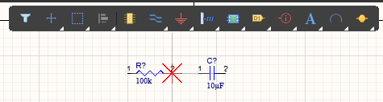{ width="800" style="display: block; margin: 0 auto;" }

Una vez que todos los componentes están conectados, este programa no requiere simular errores: se puede crear directamente un documento de PCB y transferir a él los componentes del esquemático.

### Pasar Esquemático a PCB

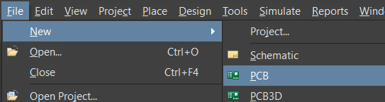{ width="800" style="display: block; margin: 0 auto;" }

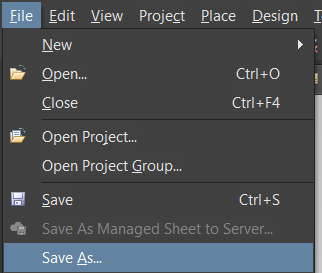{ width="600" style="display: block; margin: 0 auto;" }

Primero se debe crear un documento PCB y guardarlo. Es importante señalar que el esquemático no puede transferirse al documento PCB hasta que ambos documentos se hayan guardado en la misma carpeta.

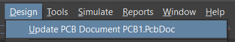{ width="800" style="display: block; margin: 0 auto;" }

Finalmente, se aceptan los cambios configurados, se ejecutan y, a continuación, se abre el documento PCB con los componentes deseados.

## PCB

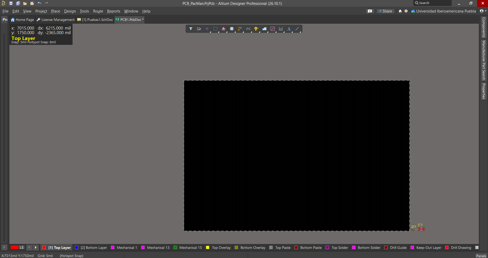{ width="800" style="display: block; margin: 0 auto;" }
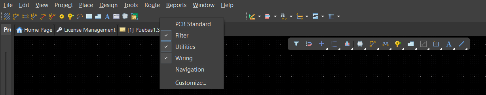{ width="800" style="display: block; margin: 0 auto;" }

En la pantalla principal se pueden ver los diferentes modos y herramientas, junto con los componentes trasladados, que aparecen en la esquina inferior derecha. Al igual que en el esquemático, el menú de herramientas se abre haciendo clic derecho sobre la barra superior.

### Rules

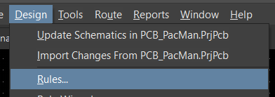{ width="800" style="display: block; margin: 0 auto;" }

Antes de conectar las pistas, se deben configurar las reglas de las pistas y las generales del documento. Para ello, hay que ir al menú superior, abrir la opción Design y localizar la sección Rules.

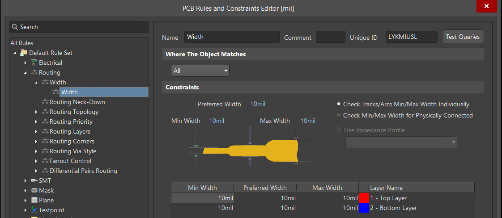{ width="800" style="display: block; margin: 0 auto;" }
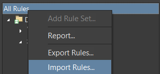{ width="800" style="display: block; margin: 0 auto;" }

Una vez dentro de la sección, se pueden modificar manualmente los anchos de las pistas o importar las reglas de fabricación de la empresa que fabricará la placa. Para acceder a esta opción de importación, se hace clic derecho sobre la sección “All Rules”.

### Routing

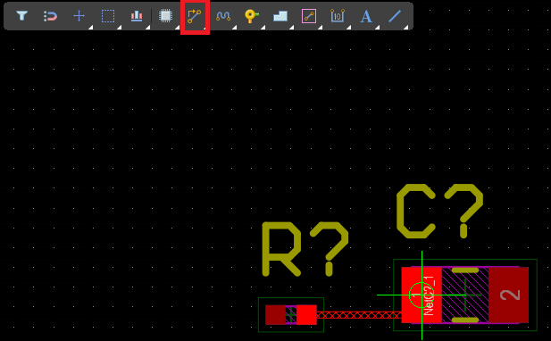{ width="800" style="display: block; margin: 0 auto;" }
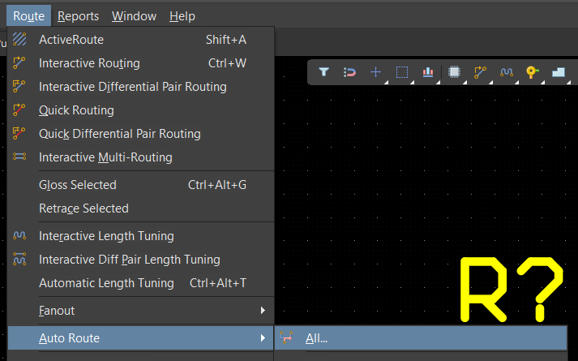{ width="800" style="display: block; margin: 0 auto;" }

Para generar las conexiones entre componentes, se utiliza la herramienta de enrutamiento (Routing), que se puede seleccionar desde la barra de herramientas de la pantalla principal y permite trazar las pistas manualmente. También es posible conectarlas de forma automática: en el menú “Route”, se selecciona la opción de enrutamiento automático (Auto Route).

### Layers, Bordes, y Capa de Tierra

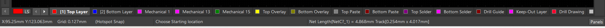{ width="1000" style="display: block; margin: 0 auto;" }

Tanto Altium como KiCad permiten cambiar entre capas, lo cual resulta muy útil porque se trabaja principalmente con cuatro: Top Layer y Bottom Layer, donde se colocan los componentes; Mechanical 1, donde se define el contorno de la PCB; y Top Overlay, donde se agregan las etiquetas.

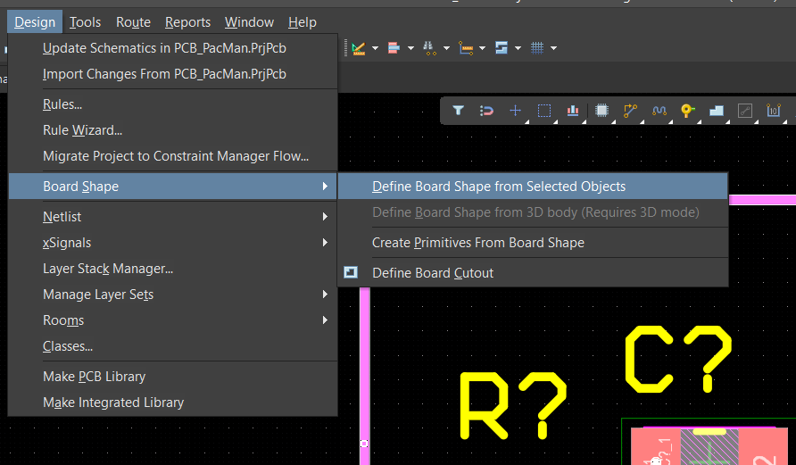{ width="1000" style="display: block; margin: 0 auto;" }
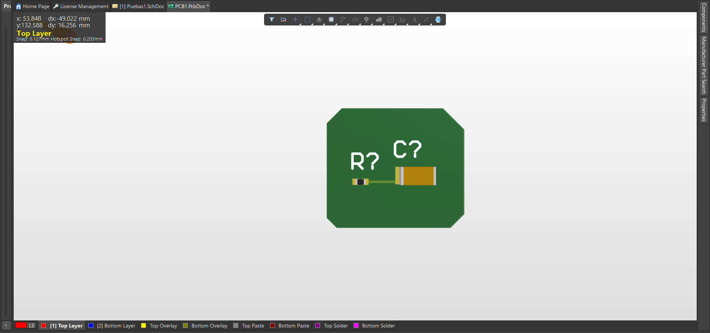{ width="1000" style="display: block; margin: 0 auto;" }

Cuando ya todo esta conectado, se pueden genarar los contornos. Para esto, se debe de mover a la capa de Mechanical, y contornear con la herramienta de Lines o Poligonos

{ width="1000" style="display: block; margin: 0 auto;" }
{ width="1000" style="display: block; margin: 0 auto;" }
{ width="1000" style="display: block; margin: 0 auto;" }
{ width="1000" style="display: block; margin: 0 auto;" }

Luego, para generar el plano de tierra, se repite el procedimiento anterior, volviendo a la capa Top Layer o Bottom Layer, según se necesite. Se selecciona la herramienta de polígono y se traza el contorno de la zona; después, se hace doble clic sobre el polígono para abrir sus propiedades y, en el panel derecho, se cambia el campo Net a la red necesaria, que en la mayoría de los casos es GND.

{ width="1000" style="display: block; margin: 0 auto;" }
{ width="1000" style="display: block; margin: 0 auto;" }
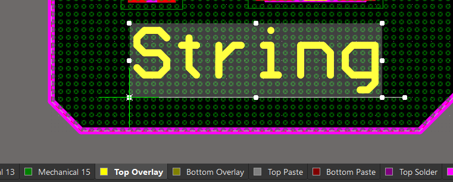{ width="1000" style="display: block; margin: 0 auto;" }

Además, en la capa Top Overlay se pueden agregar etiquetas a cada componente.
