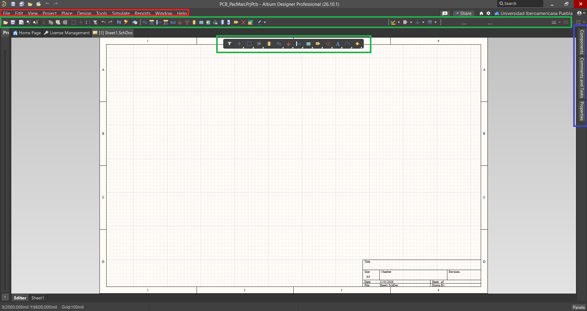
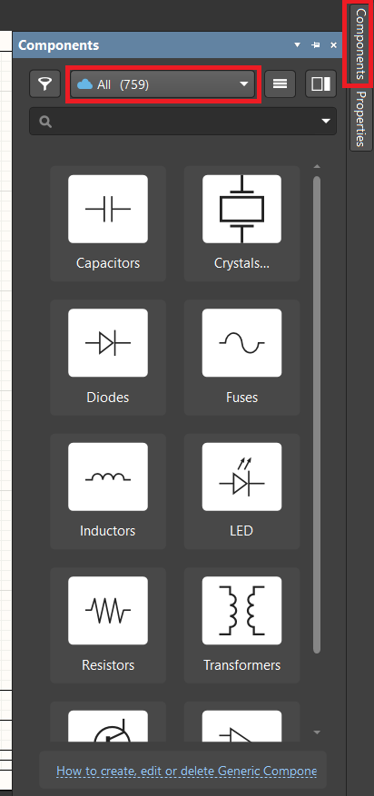
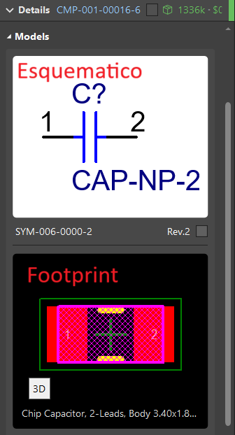
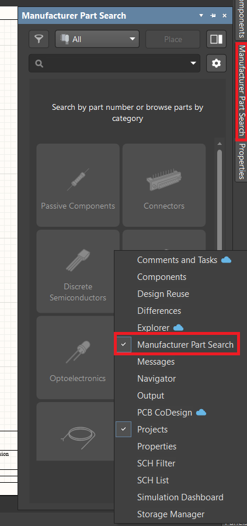
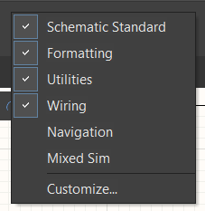

{ width="300" style="display: block; margin: 0 auto;" }

Altium Designer es la plataforma más conocida de la marca Altium, la cual se enfoca principalmente en el desarrollo de esquemáticos, diseño de PCB, visualización 3D y los archivos de fabricación, en caso de que se quiera mandar a fabricar con una compañía externa.

## Introducción a Altium

{ width="1000" style="display: block; margin: 0 auto;" }

Lo primero que se debe hacer cuando se inicia Altium es elegir una licencia, ya que este programa no se puede usar sin una licencia. Por parte de la IBERO Puebla se proporciona esta licencia si se requiere, por lo cual se debe solicitar la licencia y, cuando se tenga, iniciar sesión en el workspace de la IBERO.

{ width="1200" style="display: block; margin: 0 auto;" }

Como se puede ver, cuando se inicia sesion, de debe seleccionar la licencia profesional, y debe aparecer en verde. Ya con eso, se puede trabajar en el programa.

## Crear un nuevo proyecto

{ width="800" style="display: block; margin: 0 auto;" }

Para crear un nuevo documento, se va a la esquina superior izquierda, al menú File, y se seleccionan primero los esquemáticos.

## Esquematicos

{ width="800" style="display: block; margin: 0 auto;" }

Cuando se entra por primera vez a los esquemáticos, se tienen tres menús principales. El recuadro azul representa el espacio para insertar o crear componentes, el cual está en la barra lateral derecha; luego están los recuadros verdes, que son las barras de herramientas que se pueden utilizar en el esquemático, las cuales están en la parte superior de la pantalla; y finalmente, el recuadro rojo muestra las configuraciones externas del documento.

### Insertar componentes

{ width="400" style="display: block; margin: 0 auto;" }

En la barra lateral derecha, en la sección de componentes, se pueden insertar componentes al esquemático buscándolos por tipo, especificaciones o el nombre que se requiera.

{ width="600" style="display: block; margin: 0 auto;" }

Antes de insertar cualquier componente, se debe revisar que dentro de las especificaciones venga un esquemático del componente y el footprint de este.

{ width="600" style="display: block; margin: 0 auto;" }

En caso de que alguno de los componentes no se encuentre en la parte de componentes, se puede ir a la configuración del panel, ubicada en la esquina inferior derecha, y añadir “Manufacturer Part Search”, la cual proporciona un catálogo más amplio de componentes que se encuentran o se requieren normalmente en los proyectos.

## Herramientas

{ width="1000" style="display: block; margin: 0 auto;" }

Las primeras herramientas con las que nos cruzamos son las flotantes sobre el esquemático, las cuales incluyen filtro, mover, seleccionar, alinear, insertar parte, insertar cable, poner Ground o VDD, entre otras. Es útil tenerlas a la mano porque son las que más se ocupan al construir el esquemático.

{ width="1000" style="display: block; margin: 0 auto;" }

{ width="400" style="display: block; margin: 0 auto;" }

Posteriormente, arriba de esas están el resto de las herramientas, las cuales se pueden desbloquear al hacer clic derecho sobre la barra y seleccionar el paquete de herramientas necesario de acuerdo con el proyecto.

## Editor de Placas

{ width="800" style="display: block; margin: 0 auto;" }

La página principal del editor de placas muestra inicialmente todos los componentes agrupados en un mismo punto, los cuales debemos acomodar de forma ordenada según como queremos que quede nuestra placa. Sin embargo, antes de realizar las conexiones, es fundamental configurar las tolerancias y las medidas de las pistas.

{ width="300" style="display: block; margin: 0 auto;" }

{ width="500" style="display: block; margin: 0 auto;" }

{ width="800" style="display: block; margin: 0 auto;" }

En la esquina superior izquierda, se va a ver un menú que va a decir "Pista: usar el ancho de clase de red". Al abrir ese menú, se puede desplegar para modificar las configuraciones que la placa debe tener, las cuales son: mínimo 0.4 mm de pista, 0.4 mm mínimo de margen, y 0.8 mm mínimo de taladro. Estos son los únicos valores que se deben modificar en los menús de configuración.

{ width="300" style="display: block; margin: 0 auto;" }

{ width="300" style="display: block; margin: 0 auto;" }

Es crucial mencionar la importancia de las capas. Por cada capa, se deben hacer distintas cosas: en la capa de Edge Cuts deberían ir los contornos, en F.Cu las pistas, etc. Esto es así para que, cuando se deba mandar a cortar la placa, se haga distinción entre los diferentes tipos de corte.

{ width="800" style="display: block; margin: 0 auto;" }

Dentro de la capa F.Cu, y utilizando las configuraciones de medidas previamente establecidas, ya podemos trazar las pistas. Una ventaja significativa de la herramienta de pistas es que al seleccionar un componente, el sistema resalta automáticamente el trayecto hacia los demás elementos que comparten la misma conexión, guiándonos visualmente en el ruteo.

Para trabajar con precisión, debemos asegurarnos de que la unidad de medida en el panel izquierdo esté configurada en milímetros (mm) en el panel izquierdo.

{ width="800" style="display: block; margin: 0 auto;" }

En Edge Cuts se le da la forma que se desee a la placa; en User 1 se colocan las etiquetas de los componentes, y en User 2 se ponen los agujeros necesarios para entradas y salidas. Las demás capas User también se pueden utilizar para algún otro agujero o cualquier otra cosa que se requiera.

IMPORTANTE:

- Contornos: 2 mm
- Pistas: 0.4 - 0.6 mm
- Etiquetas: 0.4 - 0.6 mm

{ width="800" style="display: block; margin: 0 auto;" }

{ width="800" style="display: block; margin: 0 auto;" }

{ width="800" style="display: block; margin: 0 auto;" }

Una vez colocados todos los componentes y finalizadas las diferentes capas del diseño, para exportar los documentos se debe localizar el menú Archivo en la parte superior izquierda, buscar Fabricación y luego seleccionar Gerbers. Al entrar a ese nuevo menú, se hacen varias modificaciones: primero, en el menú de arriba se cambia de "Gerbers" a "SVG"; luego, se seleccionan las capas que se utilizaron para trazar; después, se corre un DRC para verificar que no haya ningún error, y si todo es correcto, se le da clic en "Trazar" para generar los documentos en formato SVG listos para ser enviados a producción o corte.

