{ width="300" style="display: block; margin: 0 auto;" }

Altium Designer es la plataforma más conocida de la marca Altium, la cual se enfoca principalmente en el desarrollo de esquemáticos, diseño de PCB, visualización 3D y los archivos de fabricación, en caso de que se quiera mandar a fabricar con una compañía externa.

## Introducción a Altium

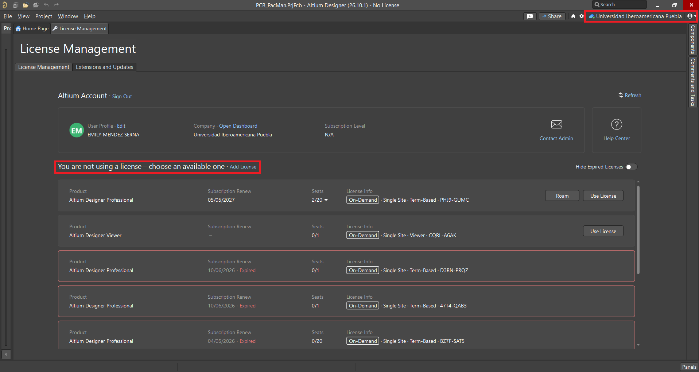{ width="1000" style="display: block; margin: 0 auto;" }

Lo primero que se debe hacer cuando se inicia Altium es elegir una licencia, ya que este programa no se puede usar sin una licencia. Por parte de la IBERO Puebla se proporciona esta licencia si se requiere, por lo cual se debe solicitar la licencia y, cuando se tenga, iniciar sesión en el workspace de la IBERO.

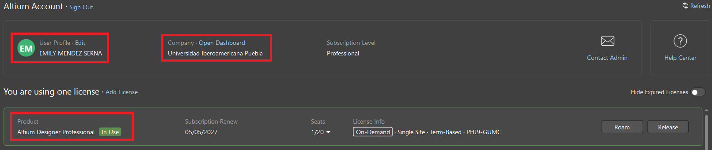{ width="1200" style="display: block; margin: 0 auto;" }

Como se puede ver, cuando se inicia sesion, de debe seleccionar la licencia profesional, y debe aparecer en verde. Ya con eso, se puede trabajar en el programa.

## Crear un nuevo proyecto

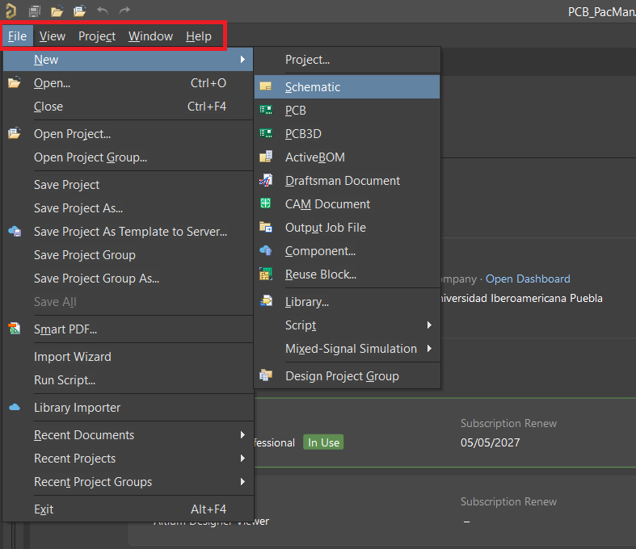{ width="800" style="display: block; margin: 0 auto;" }

Para crear un nuevo documento, se va a la esquina superior izquierda, al menú File, y se seleccionan primero los esquemáticos.

## Herramientas

{ width="350" style="display: block; margin: 0 auto;" }

La sección de Herramientas nos permite ampliar las capacidades del software mediante el Administrador de Complementos y Contenido, dándonos acceso a un catálogo amplio y variado de recursos muy útiles para nuestros proyectos.

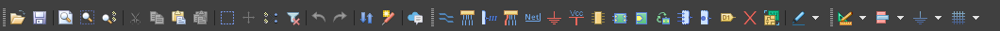{ width="800" style="display: block; margin: 0 auto;" }

Para incorporar nuevas librerías, debemos acceder a la sección de Repositorios y luego a Bibliotecas, donde buscaremos específicamente la biblioteca "KiCad FabLib". Para instalarla, simplemente entramos a ese repositorio, hacemos clic en "Instalar" y despues en "Aplicar Cambios Pendientes". Por último, debemos reiniciar la aplicación para que los nuevos recursos aparezcan disponibles en la sección de esquemáticos.

## Editor de Esquemáticos

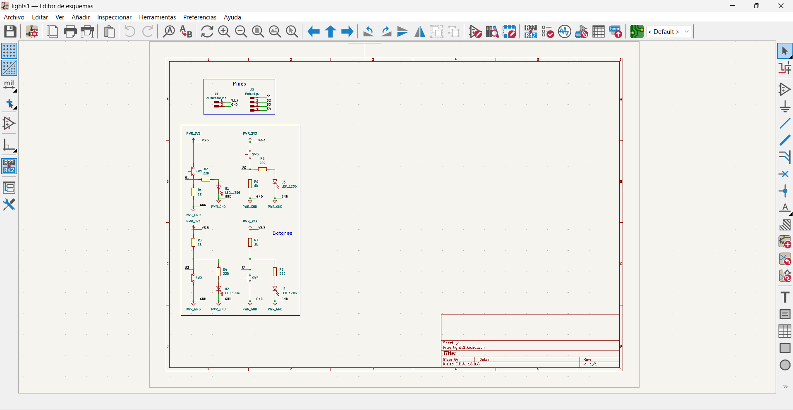{ width="800" style="display: block; margin: 0 auto;" }

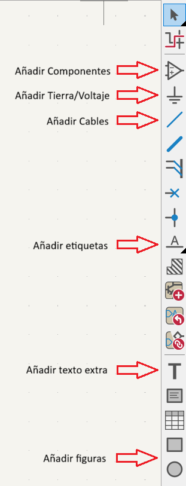{ width="300" style="display: block; margin: 0 auto;" }

Al ingresar al editor de esquemáticos, dispondremos de una barra lateral en el costado derecho que concentra todas las funciones necesarias para estructurar nuestro circuito.

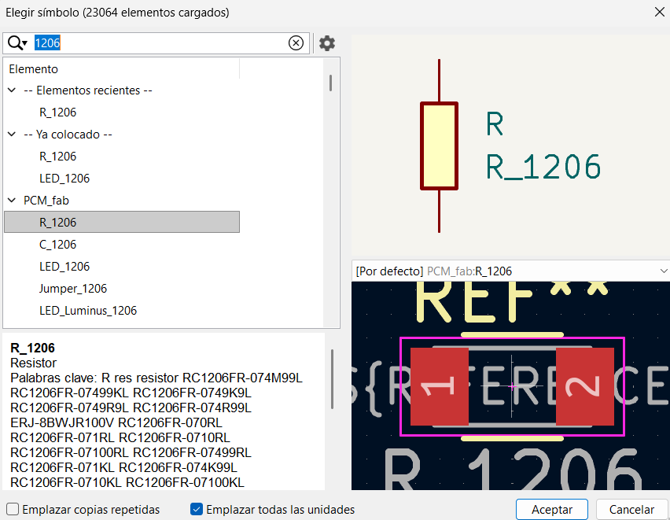{ width="800" style="display: block; margin: 0 auto;" }

Dentro de la seccion para añadir componentes, nuestros proyectos se recomienda utilizar componentes de tamaño 1206. Al haber instalado previamente la librería FabLib, bastará con buscar "1206" para localizar fácilmente los componentes compatibles con este tamaño. Asimismo, se debe verificar que cada componente incorporado en el esquemático cuente con su respectiva huella (blueprint).

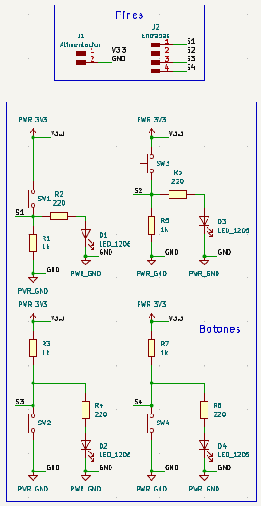{ width="400" style="display: block; margin: 0 auto;" }

Una vez finalizado el circuito, el resultado ideal debe mostrar todas las conexiones debidamente realizadas, los componentes etiquetados, los pines de entrada y salida definidos, así como las alimentaciones de voltaje y tierra claramente establecidas. 

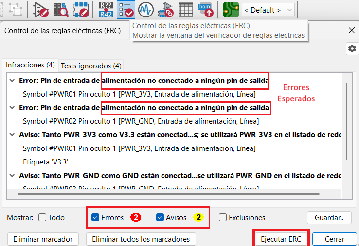{ width="600" style="display: block; margin: 0 auto;" }

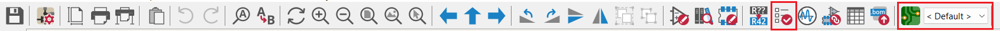{ width="1000" style="display: block; margin: 0 auto;" }

Cuando el diseño esté listo, debemos hacer clic en el ícono de verificación (checklist) ubicado en la barra superior para ejecutar una prueba ERC (Electrical Rules Check), la cual detectará posibles errores en el esquemático. Los únicos avisos normales o esperados en esta prueba suelen ser los que indican que las tierras y voltajes no están conectados a nada externamente. Una vez finalizado, hacemos clic en el botón situado en el extremo derecho de la barra superior para pasar del esquemático al editor de placas.

## Editor de Placas

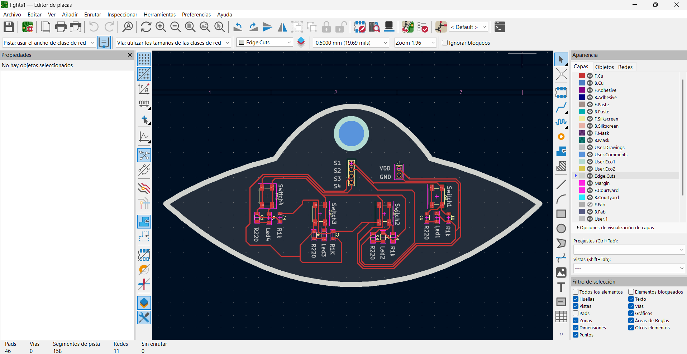{ width="800" style="display: block; margin: 0 auto;" }

La página principal del editor de placas muestra inicialmente todos los componentes agrupados en un mismo punto, los cuales debemos acomodar de forma ordenada según como queremos que quede nuestra placa. Sin embargo, antes de realizar las conexiones, es fundamental configurar las tolerancias y las medidas de las pistas.

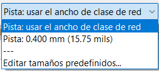{ width="300" style="display: block; margin: 0 auto;" }

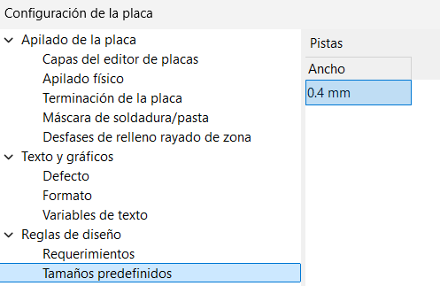{ width="500" style="display: block; margin: 0 auto;" }

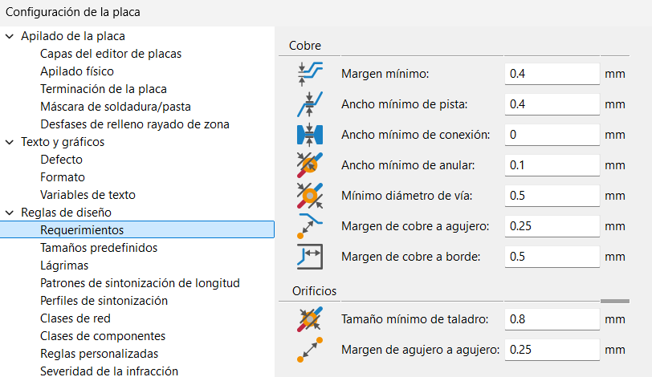{ width="800" style="display: block; margin: 0 auto;" }

En la esquina superior izquierda, se va a ver un menú que va a decir "Pista: usar el ancho de clase de red". Al abrir ese menú, se puede desplegar para modificar las configuraciones que la placa debe tener, las cuales son: mínimo 0.4 mm de pista, 0.4 mm mínimo de margen, y 0.8 mm mínimo de taladro. Estos son los únicos valores que se deben modificar en los menús de configuración.

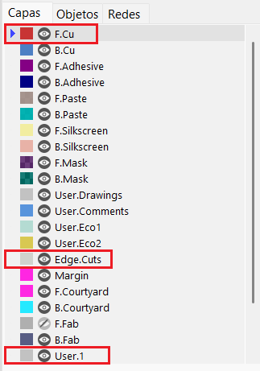{ width="300" style="display: block; margin: 0 auto;" }

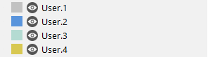{ width="300" style="display: block; margin: 0 auto;" }

Es crucial mencionar la importancia de las capas. Por cada capa, se deben hacer distintas cosas: en la capa de Edge Cuts deberían ir los contornos, en F.Cu las pistas, etc. Esto es así para que, cuando se deba mandar a cortar la placa, se haga distinción entre los diferentes tipos de corte.

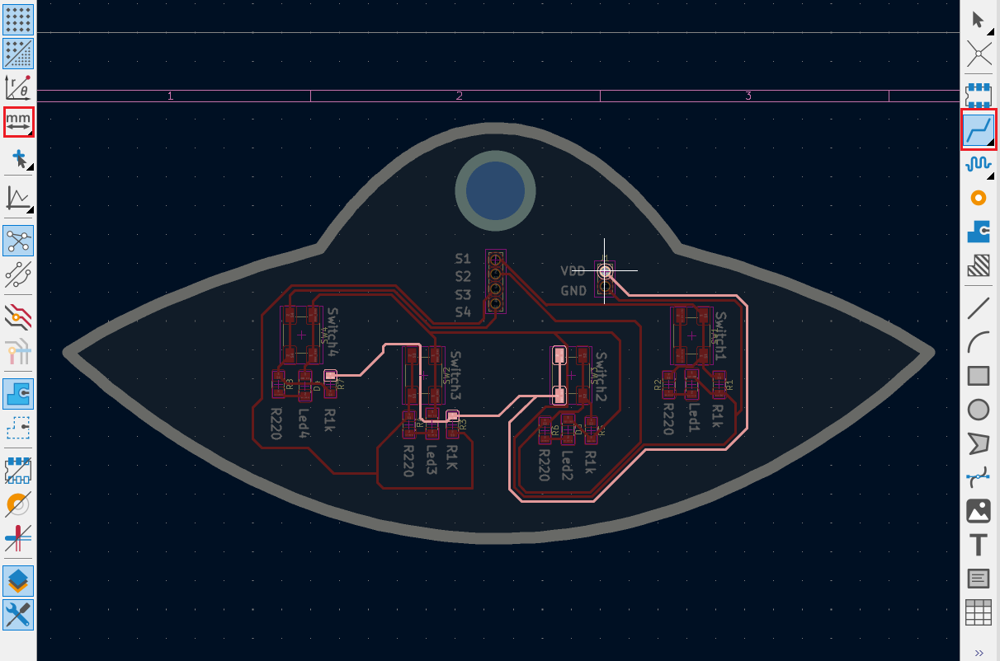{ width="800" style="display: block; margin: 0 auto;" }

Dentro de la capa F.Cu, y utilizando las configuraciones de medidas previamente establecidas, ya podemos trazar las pistas. Una ventaja significativa de la herramienta de pistas es que al seleccionar un componente, el sistema resalta automáticamente el trayecto hacia los demás elementos que comparten la misma conexión, guiándonos visualmente en el ruteo.

Para trabajar con precisión, debemos asegurarnos de que la unidad de medida en el panel izquierdo esté configurada en milímetros (mm) en el panel izquierdo.

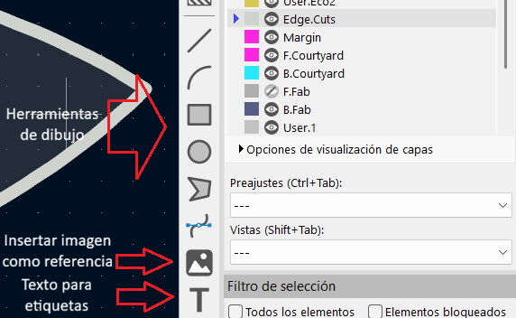{ width="800" style="display: block; margin: 0 auto;" }

En Edge Cuts se le da la forma que se desee a la placa; en User 1 se colocan las etiquetas de los componentes, y en User 2 se ponen los agujeros necesarios para entradas y salidas. Las demás capas User también se pueden utilizar para algún otro agujero o cualquier otra cosa que se requiera.

IMPORTANTE:

- Contornos: 2 mm
- Pistas: 0.4 - 0.6 mm
- Etiquetas: 0.4 - 0.6 mm

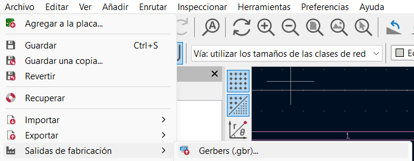{ width="800" style="display: block; margin: 0 auto;" }

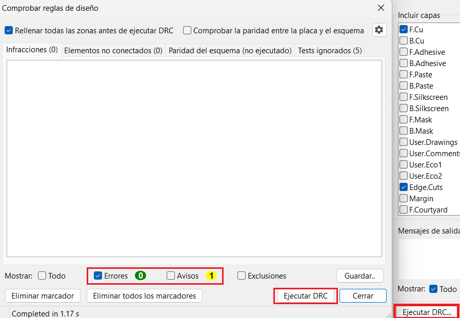{ width="800" style="display: block; margin: 0 auto;" }

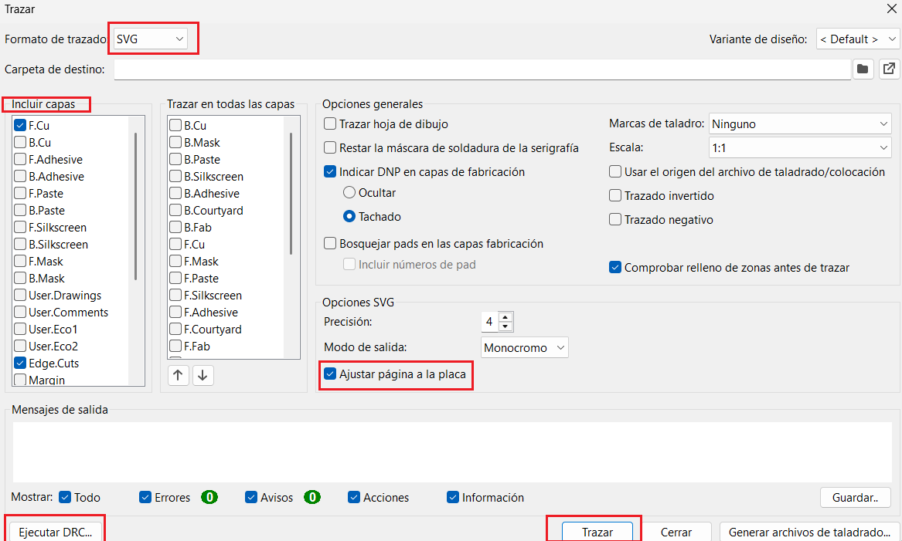{ width="800" style="display: block; margin: 0 auto;" }

Una vez colocados todos los componentes y finalizadas las diferentes capas del diseño, para exportar los documentos se debe localizar el menú Archivo en la parte superior izquierda, buscar Fabricación y luego seleccionar Gerbers. Al entrar a ese nuevo menú, se hacen varias modificaciones: primero, en el menú de arriba se cambia de "Gerbers" a "SVG"; luego, se seleccionan las capas que se utilizaron para trazar; después, se corre un DRC para verificar que no haya ningún error, y si todo es correcto, se le da clic en "Trazar" para generar los documentos en formato SVG listos para ser enviados a producción o corte.

